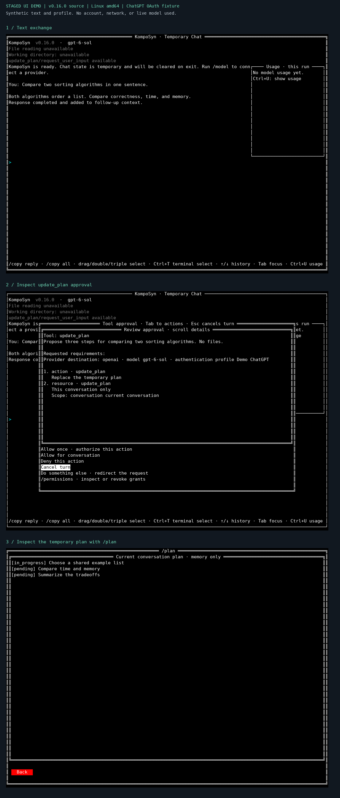

# KompoSyn

KompoSyn is an experimental terminal experience evolving toward a modular
agent harness. It is for developers who want to try an early implementation,
inspect tool approvals, and help shape what comes next.

Today you can exchange text with OpenAI or Anthropic, build a temporary plan,
and answer model clarification questions. You choose the provider and model
and inspect proposed tool actions before approving them. Conditional Linux
file reads let you try disclosing one exact synthetic file. This is an early
experiment with in-memory conversations; expect gaps and bring feedback.

**Start with the [five-minute guided trial](docs/harness/first-use.md).** It
covers installation, provider selection, a text exchange, and a plan approval.
For local token usage and cost reports, go directly to
[Token Logger](#token-logger).

## See the experience

<details>
<summary>View staged terminal demo</summary>



</details>

This illustration captures the actual bundled UI with synthetic replies and
tool events. It is staged, not a live provider session. The
[text walkthrough](docs/harness/first-use.md) gives equivalent actions;
the [verification record](docs/harness/first-use-evidence.md) separates the
capture from installation checks and prior source-build live evidence.
A fresh v0.16.0 signed-binary live trial remains pending.

## Try it

Before connecting, know that submitted text and approved tool results go to
the selected provider. Conversations, plans, selection, tool grants, and usage
stay in memory. Validated API keys and OAuth tokens persist as **plaintext**
in a private local auth file; UI settings also persist. See
[chat data handling](docs/harness/phase-one-security.md).

### Linux and macOS

With Bash, `curl`, `jq`, `tar`, `sha256sum` or `shasum`, and
[Cosign v2.4.3](https://docs.sigstore.dev/cosign/system_config/installation/)
on `PATH`, install the latest stable signed binary:

```sh
curl -fsSL https://raw.githubusercontent.com/ayeshLK/komposyn/master/scripts/install.sh | bash
```

This runs the installer from the moving `master` branch. It defaults to
`~/.local/bin` and leaves `PATH` unchanged; add that directory to your shell's
`PATH` if needed. For setup, immutable script downloads, version pinning, and
signature verification, see the [installation guide](docs/installation.md#linux-and-macos).

### Windows

Follow the [Windows installation guide](docs/installation.md#windows).
It requires PowerShell 5.1 or 7 and Cosign v2.4.3, and covers `PATH` setup.

### Start the chat

1. Check and launch it in an interactive terminal:

   ```sh
   komposyn --version
   komposyn --help
   komposyn
   ```

2. Open `/model`, add an OpenAI API key, **Continue with ChatGPT**, or an
   Anthropic API key, then explicitly choose a model. Network access and an
   eligible provider account are required; ChatGPT plan authorization is
   separate from API-key billing.
3. Follow the [guided trial](docs/harness/first-use.md#2-exchange-text-and-try-a-plan)
   to exchange text, request `update_plan`, inspect the approval, and open
   `/plan`. The basic trial needs no workspace or file-access backend.

The walkthrough targets released
[v0.16.0](https://github.com/ayeshLK/komposyn/releases/tag/v0.16.0).
Prior live ChatGPT OAuth checks cover one account/model on one Linux host
using source builds. Other live routes and broader platforms remain
unverified; consult the [capability matrix](docs/harness/capability-availability.md).
For build instructions, see the [harness guide](docs/harness/README.md).
For upgrades and removal, see [installation](docs/installation.md); uninstalling
preserves auth/settings and separate Token Logger data.

## Capabilities and limits

Bundled OpenAI Responses and Anthropic Messages adapters support text chat
and conversation-local `update_plan` and `request_user_input` on explicitly
supported routes. `/permissions` lets you inspect and revoke temporary grants.
The [harness guide](docs/harness/README.md) explains controls and lifecycle.

`read_file` is optional and conditional on Linux with a trusted
`/usr/bin/bwrap`, usable namespaces/seccomp, and successful host inspection.
Each **Read approval** permits one read and shows the exact **Read target**
and **Provider destination**; selecting a working directory grants no read access.
Use only synthetic content for the [optional file trial](docs/harness/first-use.md#4-optionally-disclose-one-synthetic-linux-file).
Native evidence remains limited to recorded Linux amd64/Bubblewrap profiles.

File mutation, shell execution, web/image tools, MCP, persistent conversations,
projects, sessions, and persistent tasks are unavailable. Provider and UI
contracts are experimental and role-specific, with implementations explicitly
bundled in the executable. General third-party plugin loading, a universal
plugin API, and a marketplace are proposed direction, not current features.

## Token Logger

Token Logger is independently useful today: it reads supported provider-owned
local usage records and produces token usage and cost reports across tools,
projects, and sessions without capturing prompts, responses, or credentials.

- **Use the production CLI:** install and operate
  [`komposyn-lg`](https://github.com/ayeshLK/komposyn-lg#install) from its
  separately maintained repository.
- **Integrate the Go library:** this repository owns the single module
  `github.com/ayeshLK/komposyn`; start with the [core API](docs/core-api.md)
  and [operation and data guides](docs/README.md#project-and-token-logger-core).

Core owns the models, SQLite storage/migrations, adapters, collection, pricing,
diagnostics, and reports. The production CLI owns settings, consent,
data-directory selection, process lifecycle, and JSONL transport. Its sidecar
is a Token Logger integration contract. It does not define a general plugin
protocol. This repository releases experimental `komposyn` binaries under its
repository-wide version; `komposyn-lg` remains independently versioned.

## Shape what comes next

KompoSyn builds useful components before composing them into a broader agent
harness. The current chat explores provider/UI boundaries and explicit tool
authority; the eventual runtime, plugin lifecycle, distribution, and trust
model remain open. Read the [vision](docs/vision.md) and
[architecture](docs/architecture.md) to propose a concrete next step.

After trying it, [open a feedback issue](https://github.com/ayeshLK/komposyn/issues/new)
with your version, OS/architecture, provider/auth route, expected and observed
behavior, and where the trial became unclear. Remove credentials, prompts,
responses, private paths, and account identifiers. Voluntary feedback helps
us test whether the experience is useful; there is no trial telemetry.

For contributions, start with [CONTRIBUTING.md](CONTRIBUTING.md) and the
[documentation index](docs/README.md). For vulnerabilities or sensitive-data
exposure, use [private security reporting](SECURITY.md#reporting-a-vulnerability).
Do not post sensitive findings in public issues.

Apache-2.0 licensed; see [LICENSE](LICENSE) and [NOTICE](NOTICE).
