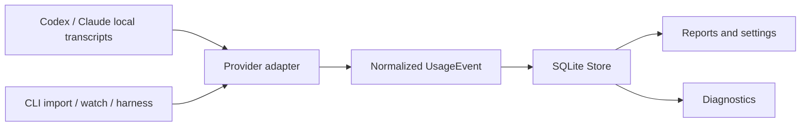

# Architecture

## Implemented today

KompoSyn currently implements the Token Logger component. Provider-owned
transcript files are read by adapters, normalized into the library event model,
and persisted in SQLite. The CLI is an orchestration and presentation layer; it
does not own the database schema or provider parsing rules.

This architecture is implemented in this repository. It is not a description
of a general harness runtime or a universal plugin API.

## Component boundaries

- `plugins/library/token-logger/` contains the domain model, SQLite store,
  numbered migrations, provider adapters, collector, pricing, diagnostics,
  and reporting.
- `plugins/cli/token-logger/` contains command dispatch, interactive setup,
  output formatting, settings and consent policy, process lifecycle, and the
  versioned harness protocol. It calls library APIs instead of querying
  SQLite directly.
- The supported reusable Go adapter surface and intentional pre-1.0 API
  compatibility decisions are recorded in [core-api.md](core-api.md).
- `docs/HARNESS_PROTOCOL.md` is the normative contract for machine-readable
  JSONL requests and responses. Changes to that contract require a protocol
  version decision and compatibility tests.

## Relationship to the future harness

The intended KompoSyn direction is to compose independently useful components
into a broader agent harness. That composition layer does not exist yet. Its
plugin lifecycle, discovery and distribution model, trust boundary, and the
question of whether every component needs a standalone CLI remain open design
questions. Do not treat the Token Logger library, CLI, or sidecar as a
completed general plugin contract.

## Import and collection flow

An explicit `import` and the background collector use the same adapters:

1. The collector canonicalizes and deduplicates roots/files, isolates
   recoverable discovery failures, and reads each source into one immutable
   byte snapshot with `os.ReadFile`.
2. Provider detection, fingerprinting, and parsing use that same byte slice
   with no scanner token ceiling, so offsets and hashes cannot describe
   different file contents.
3. Provider records are mapped to `UsageEvent`, with source adapter, source
   identity, record identity, byte offset, and record hash retained for
   traceability. Pricing-relevant billing context is stored only when its
   normalized value and controlled evidence are available; absent context stays
   unknown.
4. Adapter-scoped aliases and canonical local locations reconcile provider
   references to KompoSyn-owned project/session IDs. Existing aliases win;
   unique location matches may connect clients, while ambiguous or conflicting
   evidence remains isolated and produces a path-free local warning.
5. Identity mappings, project and session references, events, and the source
   cursor are committed atomically.
6. A full digest plus committed cursor flags can classify an exactly unchanged,
   reusable snapshot before parsing. Pending-tail state remains visible. Files
   with incomplete accounting are reparsed; size or mtime alone is never used
   as accounting truth.
7. Changed sources are parsed and remain idempotent through stable ingestion
   keys; duplicates are reported rather than inserted again.

`RunImmediate` performs an initial scan and then polls at its configured
interval. Discovery and parsing observe cancellation between safe boundaries;
a persistence transaction already in progress completes atomically. Embedded
owners cancel and join the worker before closing its Store. Lifecycle
(`starting`, `running`, `stopped`) is separate from latest poll health. It never
writes to provider-owned source files.

Persistent roots, the singleton runtime lease, random instance identity,
heartbeat, cooperative stop request, cumulative typed outcomes, and sanitized
health are application-owned SQLite state. The detached child reloads enabled
roots before each poll and canonical discovery deduplicates overlapping roots.
Unix children start in a new session; Windows children use detached/new-process
group flags without a console window. Terminal streams are not inherited and
no network listener is opened.

The REPL's embedded collector acquires the same lease. With a healthy
background owner, the REPL reads persisted status instead and does not stop the
background process on exit. A stored PID is informational: stop and stale
recovery use instance identity and heartbeat, never a signal sent solely from
that PID.

## Source replacement safety

The cursor stores the last committed byte offset and source fingerprint. When a
file grows and its already-processed prefix still matches, it is treated as an
append. If the prefix no longer matches, the source is a replacement and a new
source generation is used. This prevents reused offsets from colliding with
events imported from an older version of the file.

## Persistence boundary

`Store.Open` configures SQLite with foreign keys enabled, WAL journaling, and a
bounded five-second busy timeout, limits each Store's connection pool to one
connection, then applies migrations before returning. This allows independent
foreground/embedded Stores to wait boundedly for ordinary write contention;
failures remain visible rather than retrying indefinitely. Writes that affect
related metadata, events, and cursors use one transaction.
The database is application-owned; source transcripts remain provider-owned and
read-only from KompoSyn's perspective.

Unchanged-poll benchmarks cover small and 10,000-record histories and report
time, allocations, bytes, and historical events resubmitted. On the issue #90
Linux review host, the 10,000-record unchanged case resubmitted zero events and
took about 2.5 ms. Append polls still parse history to preserve cumulative
provider context: the 1,000-record case resubmitted 1,000 historical events and
took about 130 ms. Incremental append parsing remains a measured limitation,
not part of the unchanged-snapshot optimization.

## Reporting semantics

Reports operate on normalized events and stored pricing rules. A small reviewed
catalog is embedded in the library and synchronized locally on database open;
this path is idempotent and performs no network access. Exact rational pricing
is rounded once per event to integer microunits. Public catalog calculations
are estimates, distinct from source-reported amounts; unsupported or
insufficiently described billing contexts stay unknown with a reason. Hourly grouping
uses the caller-selected reporting timezone; when none is selected, reports use
UTC. The selected IANA timezone is preserved in report output, so fractional-
offset zones and repeated hours during daylight-saving folds remain distinct.

Resource queries expose a stable hierarchy over the same facts: projects own
sessions, while models remain an event aggregation dimension rather than a
persistent child table. New resource-list JSON uses `format_version: 1`.
Legacy `sessions` report syntax remains available; `sessions list/show` is the
resource-browser surface.
