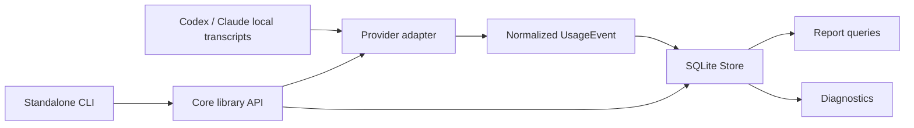

# Architecture

## Component-first direction

KompoSyn develops useful components before defining how they will compose into
a broader harness. This is a project philosophy, not an implemented plugin
runtime or universal API. The questions that remain open are recorded in the
[project vision](vision.md).

## Implemented today

KompoSyn Core implements the reusable Token Logger library. Provider-owned
transcript files are read by adapters, normalized into the library event model,
and persisted in SQLite. The independently versioned `komposyn-lg` executable
is maintained in [its standalone repository](https://github.com/ayeshLK/komposyn-lg)
and consumes this module.

This architecture is implemented in this repository. It is not a description
of a general harness runtime or a universal plugin API. This repository also
contains and releases a separate experimental temporary-chat executable named
`komposyn`; see the [chat architecture](harness/phase-one-architecture.md) and
[release verification](release-verification.md).

Issue #198 tracks a separate experimental tool-use milestone. Its initial
contract and in-memory permission foundation are under development; this
foundation enables no tool execution, sandbox backend, or web service. The
milestone does not establish a general harness runtime or plugin API.

## Component boundaries

- `plugins/library/token-logger/` contains the domain model, SQLite store,
  numbered migrations, provider adapters, collector, pricing, diagnostics,
  and reporting.
- The standalone `komposyn-lg` repository contains production command dispatch, interactive setup,
  output formatting, settings and consent policy, process lifecycle, and the
  versioned JSONL harness transport. It calls library APIs instead of querying
  SQLite directly.
- The supported reusable Go adapter surface and intentional pre-1.0 API
  compatibility decisions are recorded in [core-api.md](core-api.md).
- Structured diagnostics contract v1 adds safe typed failure projections, an
  optional bounded caller-owned observer, and observed Store opening. The
  event mailbox is transient and lossy; persisted diagnostic evidence remains
  a separate core-owned follow-up with its own internal findings path.
- The protocol-v1 contract is maintained by the standalone CLI repository.
  Core API or schema changes that affect it are validated against the public
  CLI suite in core CI.

## Relationship to the future harness

The intended KompoSyn direction is to compose independently useful components
into a broader agent harness. The experimental chat demonstrates only a
bounded provider/UI split with temporary messages; it does not settle the
broader plugin lifecycle, distribution model, trust boundary, or general
runtime. Do not treat the Token Logger library, CLI integration, or temporary
chat contracts as a universal plugin API. Its provider/method auth registry
and UI-independent login interaction are limited to this experiment; see the
[Phase 2 auth boundary](harness/phase-two-auth-boundary.md).

## Import and collection flow

An explicit `import` and the background collector use the same adapters:

1. The collector canonicalizes and deduplicates roots/files, isolates
   recoverable discovery failures, and reads each source into one immutable
   byte snapshot with `os.ReadFile`.
2. Provider detection, fingerprinting, and parsing use that same byte slice
   with no scanner token ceiling, so offsets and hashes cannot describe
   different file contents.
3. Provider records are mapped to `UsageEvent`, with source adapter, source
   identity, record identity, byte offset, and record hash retained for
   traceability. Pricing-relevant billing context is stored only when its
   normalized value and controlled evidence are available; absent context stays
   unknown.
4. Adapter-scoped aliases and canonical local locations reconcile provider
   references to KompoSyn-owned project/session IDs. Existing aliases win;
   unique location matches may connect clients, while ambiguous or conflicting
   evidence remains isolated and produces a path-free local warning.
   Project display names retain a bounded origin (`fallback`, `cwd`, provider
   name, explicit API input, or unknown). Reliable metadata may promote a
   known provisional name without changing identity; unknown historical names
   remain unchanged because their original name source was not recorded.
5. Identity mappings, project and session references, events, and the source
   cursor are committed atomically.
6. A full digest plus committed cursor flags can classify an exactly unchanged,
   reusable snapshot before parsing. Pending-tail state remains visible. Files
   with incomplete accounting are reparsed; size or mtime alone is never used
   as accounting truth.
7. Changed sources are parsed and remain idempotent through stable ingestion
   keys; duplicates are reported rather than inserted again.

`RunImmediate` performs an initial scan and then polls at its configured
interval. Discovery and parsing observe cancellation between safe boundaries;
a persistence transaction already in progress completes atomically. Embedded
owners cancel and join the worker before closing its Store. Lifecycle
(`starting`, `running`, `stopped`) is separate from latest poll health. It never
writes to provider-owned source files.

Persistent roots, the singleton runtime lease, random instance identity,
heartbeat, cooperative stop request, cumulative typed outcomes, and sanitized
health are application-owned SQLite state. The standalone CLI's background,
foreground, and embedded modes use this shared library behavior; process
launch and interactive lifecycle policy belong to the CLI repository.

## Source replacement safety

The cursor stores the last committed byte offset and source fingerprint. When a
file grows and its already-processed prefix still matches, it is treated as an
append. If the prefix no longer matches, the source is a replacement and a new
source generation is used. This prevents reused offsets from colliding with
events imported from an older version of the file.

## Persistence boundary

`Store.Open` configures SQLite with foreign keys enabled, WAL journaling, and a
bounded five-second busy timeout, limits each Store's connection pool to one
connection, then applies migrations before returning. This allows independent
foreground/embedded Stores to wait boundedly for ordinary write contention;
failures remain visible rather than retrying indefinitely. Writes that affect
related metadata, events, and cursors use one transaction.
The database is application-owned; source transcripts remain provider-owned and
read-only from KompoSyn's perspective.

Generated collector benchmarks cover both providers, cold imports, healthy
unchanged polls, append and incomplete-source cases, and file-size
distributions. See the [collector performance baseline](collector-performance-baseline.md)
for repeatable commands, work counters, correctness coverage, and proposed
improvement budgets. Healthy unchanged snapshots skip parser history and event
insertion; append polls still parse cumulative provider history, which remains
a measured limitation rather than an implemented optimization.

## Reporting semantics

Reports operate on normalized events and stored pricing rules. A small reviewed
catalog is embedded in the library and synchronized locally on database open;
this path is idempotent and performs no network access. Exact rational pricing
is rounded once per event to integer microunits. Public catalog calculations
are estimates, distinct from source-reported amounts; unsupported or
insufficiently described billing contexts stay unknown with a reason. Hourly grouping
uses the caller-selected reporting timezone; when none is selected, reports use
UTC. The selected IANA timezone is preserved in report output, so fractional-
offset zones and repeated hours during daylight-saving folds remain distinct.

Resource queries expose a stable hierarchy over the same facts: projects own
sessions, while models remain an event aggregation dimension rather than a
persistent child table. The public resource API keeps stable project/session
identities; presentation and command syntax are owned by the standalone CLI.
