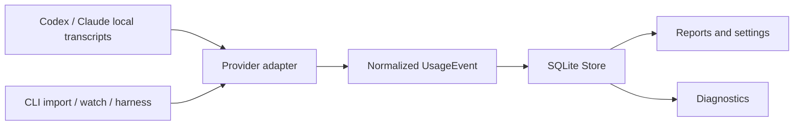

# Architecture

## Implemented today

KompoSyn currently implements the Token Logger component. Provider-owned
transcript files are read by adapters, normalized into the library event model,
and persisted in SQLite. The CLI is an orchestration and presentation layer; it
does not own the database schema or provider parsing rules.

This architecture is implemented in this repository. It is not a description
of a general harness runtime or a universal plugin API.

## Component boundaries

- `plugins/library/token-logger/` contains the domain model, SQLite store,
  numbered migrations, provider adapters, collector, pricing, diagnostics,
  and reporting.
- `plugins/cli/token-logger/` contains command dispatch, interactive setup,
  output formatting, and the versioned harness protocol. It calls library
  APIs instead of querying SQLite directly.
- `docs/HARNESS_PROTOCOL.md` is the normative contract for machine-readable
  JSONL requests and responses. Changes to that contract require a protocol
  version decision and compatibility tests.

## Relationship to the future harness

The intended KompoSyn direction is to compose independently useful components
into a broader agent harness. That composition layer does not exist yet. Its
plugin lifecycle, discovery and distribution model, trust boundary, and the
question of whether every component needs a standalone CLI remain open design
questions. Do not treat the Token Logger library, CLI, or sidecar as a
completed general plugin contract.

## Import and collection flow

An explicit `import` and the background collector use the same adapters:

1. The adapter canonicalizes the source path and reads one immutable byte
   snapshot with `os.ReadFile`.
2. The snapshot is fingerprinted and parsed. Every event is derived from that
   same byte slice, so offsets and hashes cannot describe different file
   contents.
3. Provider records are mapped to `UsageEvent`, with source adapter, source
   identity, record identity, byte offset, and record hash retained for
   traceability.
4. Project and session references, events, and the source cursor are committed
   atomically.
5. A repeated import is idempotent through the event's stable ingestion key;
   duplicates are reported rather than inserted again.

The collector performs an initial scan only when `PollOnce` is called. `Run`
then polls at its configured interval and stops when its context is cancelled.
It never writes to provider-owned source files.

## Source replacement safety

The cursor stores the last committed byte offset and source fingerprint. When a
file grows and its already-processed prefix still matches, it is treated as an
append. If the prefix no longer matches, the source is a replacement and a new
source generation is used. This prevents reused offsets from colliding with
events imported from an older version of the file.

## Persistence boundary

`Store.Open` configures SQLite with foreign keys enabled and WAL journaling,
limits the connection pool to one connection, then applies migrations before
returning. Writes that affect related metadata and events use one transaction.
The database is application-owned; source transcripts remain provider-owned and
read-only from KompoSyn's perspective.

## Reporting semantics

Reports operate on normalized events and stored pricing rules. Hourly grouping
uses the caller-selected reporting timezone; when none is selected, reports use
UTC. The selected IANA timezone is preserved in report output, so fractional-
offset zones and repeated hours during daylight-saving folds remain distinct.
