# Tool use Phase 1 architecture and decision record

Status: initial contracts, evaluator, and injected in-memory grant store are
implemented on the feature branch. No model tool is enabled and no process,
file mutation, web request, or live model call is authorized by this document.
These foundations are not enforcement. Final execution and distribution
choices remain subject to the decisions at the end of this record.

Authority: [issue #198](https://github.com/ayeshLK/komposyn/issues/198) and
[the implementation plan](tool-use-phase-one-plan.md). This is a new,
experimental milestone after the text-only temporary-chat milestone.

## Boundaries

Keep these responsibilities separate:

1. **Exposure:** provider/model/auth-route capability evidence and the
   conversation's explicitly registered tool definitions.
2. **Invocation authorization:** whether this exact tool operation is allowed.
3. **Resource authorization:** whether its resolved filesystem, command, or
   network scope is granted.
4. **Approval:** trusted user interaction for missing authority.
5. **Enforcement:** operating-system or remote-service controls that constrain
   effects even if a program ignores its description.
6. **Execution:** a trusted dispatcher that revalidates the approved request
   and invokes an implementation only after all preceding checks pass.

Tool definitions and model arguments are untrusted. In-process tool code shares
the KompoSyn process authority; an approval check does not sandbox that code.
Providers only encode/decode provider-native calls and results. They do not
execute tools, inspect grants, resolve tool credentials, or own authorization.
The runtime serializes tool calls and holds no chat lock while approval or
execution waits. The UI reports state but cannot grant authority by itself.

## In-memory records

Names are design-level identifiers; Go package ownership is `plugins/tools/`
for the role-specific contract, `internal/harness/permissions/` for policy and
grants, and `internal/harness/tools/` for registry/dispatch and process
ownership. None is a general plugin API.

| Record | Required fields | Invariant |
| --- | --- | --- |
| Tool definition | stable tool ID, description, JSON input schema, input bound, content/result bounds | exposure does not grant permission |
| Tool call | conversation ID, user-turn ID, provider call ID, tool ID, complete argument bytes and digest | partial streamed arguments are never executable |
| Action request | call identity, typed operation, validated arguments, captured cwd/environment identity, action key, requested permissions/resources | one request describes exactly what the host will run |
| Requirement | action or resource kind, canonical scope, read/write/execute/delete/network operation, whether session scope is permitted | every requirement must pass; write implies read only in the same scope |
| Approval request | opaque pending ID, conversation/call identity, argument/context digest, policy/grant revision, displayed requirements, creation state | response must match the live pending request and its unchanged revision |
| Grant | opaque grant ID, trusted origin, action key or resource scope, conversation ID, once/session lifetime, revision | only coordinator decisions can create it; delete has no session lifetime |
| Tool result | provider call ID, typed outcome, bounded text/image/source content, truncation metadata | reports execution truth; never carries authority or credentials |

All conversation IDs, grants, approvals, process handles, plans, and activity
records are memory-only. Use random opaque identity values, not paths, prompts,
credentials, or provider content. Store only digests of canonical request bytes
and execution context in approval identity; do not log those digests as a proxy
for an activity history.

An approval displays the exact command/script and cwd or exact resolved target
and operation. The response binds to those values and the policy revision.
Any change makes the approval stale and requires fresh evaluation. Before the
effect starts, the dispatcher resolves/revalidates the resource and re-evaluates
both action and resource access. A stale/duplicate/unmatched response creates
no grant. Session command grants match a complete command/script, cwd, and
requested authority; no executable-wide or prefix rule is inferred.

## Authorization and state transitions

For each required action/resource permission, evaluate trusted explicit rules
with `deny > ask > allow`; absent an applicable rule or grant, ask. An explicit
deny blocks without prompting. An explicit ask requires approval even if a
separate less-specific allow exists. An allow only satisfies the requirement
it names. The coordinator combines all missing requirements into one prompt;
execution starts only when each requirement is satisfied. If approval cannot
be displayed or enforced, the operation is not executed.

```mermaid
stateDiagram-v2
  [*] --> Received
  Received --> Rejected: malformed, partial, unknown, unavailable
  Received --> Evaluating: complete validated call
  Evaluating --> Rejected: explicit deny / capability absent
  Evaluating --> Pending: requirements need approval
  Evaluating --> Ready: requirements already satisfied
  Pending --> Ready: matching once/session approval
  Pending --> Redirected: do something else
  Pending --> Denied: deny or cancel
  Pending --> Stale: revision/context changed
  Ready --> Revalidating: immediately before effect
  Revalidating --> Stale: grants or resolved target changed
  Revalidating --> Running: policy and enforcement available
  Running --> Succeeded
  Running --> Failed
  Running --> Partial
  Running --> Unknown: effect may have happened
  Running --> Cancelled: request cancellation; no rollback claim
```

`Do something else` rejects the pending call and returns the user's
instruction for replanning; any replacement is a new call and is independently
checked. This differs from **deny**, whose user-facing continuation behavior
remains an open decision below. Pending cancellation, shutdown, or absent
interaction never silently approves. A running side effect is not erased from
the in-memory action record if a later model request fails; recovery must never
replay it automatically.

`/permissions` lists in-memory grants with origin and lifetime; individual
revocation or clear-all increments the policy revision and invalidates queued
approvals. Confirmation of a provider/model/profile change and process exit
clear conversation grants. Tool credential material is injected only into the
specific backend that needs it; it is not included in model-visible results or
ordinary chat snapshots.

## Threat model

The model, tool arguments, fetched pages, command output, patch content, image
metadata, and provider stream are untrusted. They may try to broaden authority,
read credentials, escape a directory, invoke another tool, trigger SSRF, or
hide a partial side effect. Approval text and tool output must render literally
and within bounds. Neither a prompt nor a schema is a security boundary.

The principal local threats are shell command composition, executable and
argument substitution, cwd/environment inheritance, child-process escape,
filesystem symlink/junction and TOCTOU races, access to unrelated home/config
files, network and IPC access, overlong output/runtime, orphaned processes, and
replay after cancellation or uncertain completion. Required operating-system
enforcement must fail closed. A read-only mount does not constrain reads. No
network/backend failure may switch to unsandboxed execution.

The principal remote threats are redirects and DNS rebinding to private/local
addresses, metadata services, credentials in URLs/headers, oversized or
mislabelled responses, malicious page instructions, and accidental query or
content disclosure. Search, fetch, shell networking, and ordinary model
requests are separate channels with separate policy. Redirects and resolved
addresses need validation at connection time; string URL checks alone are
insufficient.

Cancellation while approval is pending prevents start. Cancellation after a
process or network request begins requests termination but cannot promise
rollback. Outcomes distinguish not-executed, success, failure, partial, and
unknown. Retrying an unknown side effect is forbidden unless that tool proves
the retry idempotent. State and raw arguments/results are not persisted or
logged by default.

## Reference inspection and external choices

The specified local Codex checkout is at the requested revision. Its Linux
`codex-linux-sandbox` is a Rust binary plus library, not a Go library; its
Cargo manifest depends on Codex protocol, network proxy, path, process, and
platform crates. The source describes bubblewrap filesystem/namespaces plus
seccomp, a bundled-bubblewrap fallback, read-only base mounts, and additional
symlink/protected-path logic. `codex sandbox` is a CLI surface whose host code
selects platform policy; Windows includes a separately provisioned sandbox
runner and macOS uses Seatbelt. This static inspection does not prove any
backend on this host and does not prove that a copied helper preserves Codex's
policy construction or security tests. Codex's user configuration must not be
inherited as KompoSyn policy.

Options to resolve before process enablement:

| Option | Benefits | Costs and open evidence |
| --- | --- | --- |
| Require an operator-installed, exact-version Codex CLI and invoke its sandbox command | avoids shipping a second large binary; delegates to maintained native implementations | availability, CLI compatibility, and isolation must be proven per OS; prevent PATH substitution and unrelated Codex configuration; unsupported/missing version blocks execution |
| Build and package pinned Codex sandbox components | can pin source and keep normal use independent of a user installation | Linux helper has a broad Rust workspace dependency surface; macOS/Windows are not the same standalone helper; packaging, signing, licenses/notices, upgrades, and platform tests become release requirements |
| Implement narrow native backends in this repository | explicit KompoSyn policy surface and package ownership | largest security and maintenance burden; Linux namespaces/seccomp, macOS Seatbelt, and Windows process/filesystem controls need separate audits and native test rigs |

Options for search:

| Option | Benefits | Costs and limits |
| --- | --- | --- |
| Brave Search API | independent of model provider; documented HTTP API and structured URLs/snippets; current published Search plan is $5 per 1,000 requests with $5 monthly credit | requires a separately scoped service key/account; paid external dependency; query disclosure and retention terms need user-facing notice |
| Provider-hosted search | no separate search-service key in some provider routes | runs remotely outside KompoSyn host execution/authorization and is provider/auth-route-specific; not an equivalent local `web_search` implementation |
| Self-hosted search service | operator controls credentials and deployment | requires deployment/maintenance, may depend on upstream engines, and has no shared hosted availability guarantee |

The Brave API key header and current plan details were checked against its
official API documentation on 2026-10-31: [authentication](https://api-dashboard.search.brave.com/documentation/guides/authentication),
[web search reference](https://api-dashboard.search.brave.com/api-reference/web/search/get),
and [plan information](https://brave.com/search/api/). Prices and service
terms can change.

Official provider documentation describes OpenAI Responses function calling
and image inputs, and Anthropic Messages client tools and image blocks. Current
KompoSyn model catalogs report identifiers/display names, not per-model tool
or image capability. Its OpenAI OAuth route uses a separately constrained
Responses subset and has no verified tool/image evidence in this repository.
Therefore no capability is inferred from catalog presence, provider name, or
model name. Until route/model-specific evidence is recorded and tested, keep
that route's tool/image definitions hidden. References: [OpenAI function
calling](https://developers.openai.com/api/docs/guides/function-calling),
[OpenAI image inputs](https://developers.openai.com/api/docs/guides/images-vision),
[Anthropic client tool use](https://platform.claude.com/docs/en/agents-and-tools/tool-use/overview),
and [Anthropic vision](https://platform.claude.com/docs/en/build-with-claude/vision).
This is protocol support evidence, not proof of every model or auth route.

## Decisions requested before dependent integrations

These are not implied by approval of the issue's conceptual semantics:

1. **Sandbox distribution and support — deferred:** shell execution is outside
   this phase. `exec_command` and `write_stdin` remain unavailable until a
   later phase selects, implements, and natively verifies an enforcement
   backend. No unsandboxed fallback is permitted.
2. **Web tools — deferred to the immediate next phase:** this phase will not
   expose `web_search` or `web_fetch`. The next phase should implement and
   verify network authorization and enforcement, then compare provider-hosted
   search with a host-controlled search backend. Provider-hosted search avoids
   a separate search credential but gives KompoSyn less control over each
   network action; an independent backend needs its own service and credential
   decision. Do not let this deferral become an indefinite roadmap item.
3. **Provider capability policy:** tool implementations are KompoSyn
   capabilities offered to a model; model quality is not a compatibility gate.
   Verify that each provider API/auth route supports tool definitions, tool
   calls, and native continuation before exposing client tools on that route.
   Check individual model IDs only where the provider documents model-specific
   differences or the API rejects a supported operation. Unknown route support
   means tools remain unavailable on that route. Images require their own
   content-format support check.
4. **Initial bounds (proposal, not implementation defaults):** one active user
   turn; serial calls; at most 8 tool invocations and 4 provider requests per
   turn; 30-second command runtime; 256 KiB output per invocation and 1 MiB
   total tool output per turn; one owned process handle at a time with 5-minute
   maximum lifetime. Approval may wait until explicit answer/cancel/shutdown,
   but only one request may be pending. Approve/revise these ceilings before
   runtime integration.
5. **Approval denial:** maintainer decision: deny returns a typed “not
   executed” result so the model can continue along a different path. Any
   replacement action is independently authorized; the denied action is never
   retried automatically. Cancel stops the entire turn and sends no further
   provider continuation. “Do something else” supplies explicit user text and
   independently checks any resulting action.

This initial slice implements role-specific tool definitions, typed outcomes,
deterministic registry snapshots, typed action/resource requirements, rule
precedence, recursive scope matching, once/conversation grants, revocation,
atomic once-grant consumption, and a coordinator for one combined pending
approval bound to the request and grant revision. Focused unit tests exercise
these contracts, including stale responses and deletion's once-only rule. It
does not yet implement the permission UI, runtime dispatch, enforcement, or
tool implementations. A separate protocol-only dependency change adds provider
tool-call encoding and continuation for OpenAI API-key Responses and Anthropic
Messages routes; OpenAI OAuth remains unknown and must not receive tool
definitions. This protocol support does not make tools available in chat. No
shell, web, mutation, or image tool is registered until runtime authorization
and enforcement pass their acceptance tests.
